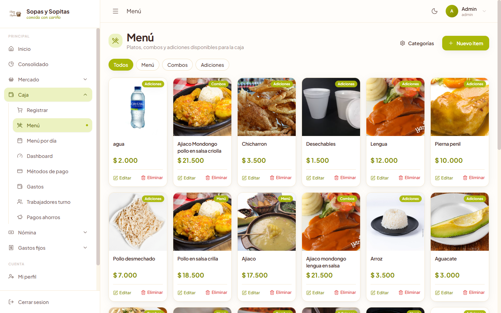
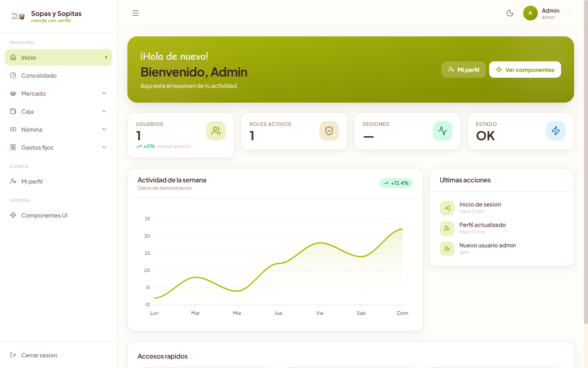
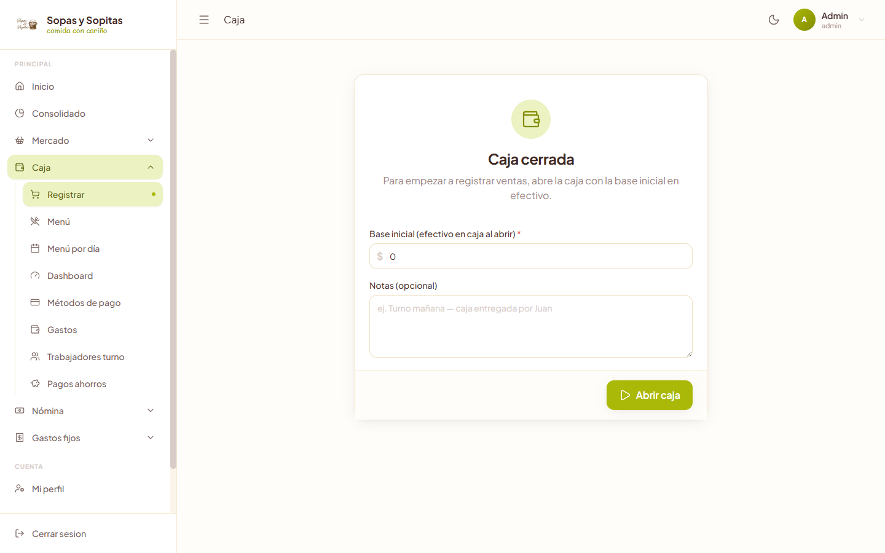
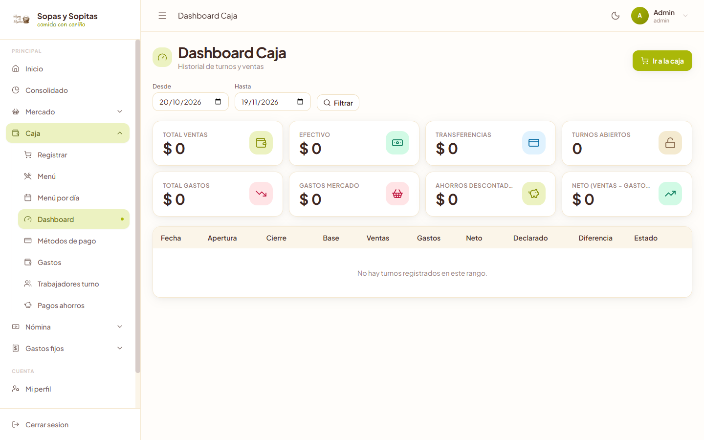
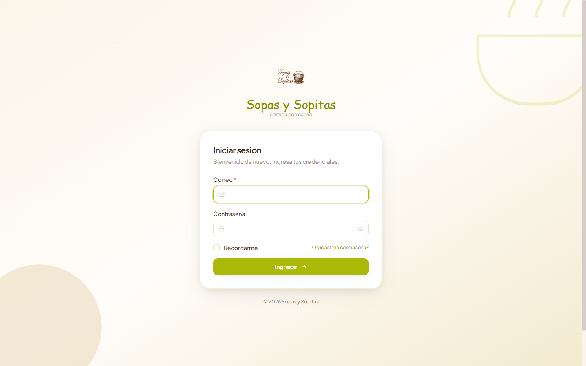

# Sopas y Sopitas — POS y gestión integral de restaurante

Sistema de caja, menú, compras de mercado, inventario, nómina y finanzas para un restaurante de sopas y comida casera.



## Contexto

Es la versión base de la familia de sistemas para restaurantes (también desplegada para Dorilokos Mix, Papas del Alma y El Pan Dorado DC). Reemplazó la caja en papel y las hojas de cálculo de compras y nómina del negocio.

## Funcionalidades

- **Caja (POS):** apertura de turno con base, venta por categorías con platos, combos y adiciones, varios métodos de pago y cierre con cuadre.
- **Menú** con fotos, combos con componentes y **menú por día de la semana**.
- **Mercado:** compras de insumos con método de pago, observaciones, listas de mercado y plantillas.
- **Inventario** vinculado a la caja (descuenta al vender) y bloqueo de stock negativo en ventas concurrentes.
- **Nómina:** empleados, liquidación, pagos masivos, prestaciones y ahorros de trabajadores.
- **Gastos, gastos fijos mensuales y consolidado general** de ingresos y egresos.
- Tablas estandarizadas (búsqueda, orden y paginación) en todo el sistema y **modo oscuro**.
- **API REST de solo lectura** (Sanctum) para la app móvil *Mis Negocios*.

## Stack

- **Backend:** PHP 8, Laravel 9, MySQL/MariaDB
- **Autenticación y permisos:** Laravel Breeze + spatie/laravel-permission (roles y permisos)
- **Frontend:** Blade, Alpine.js, Tailwind CSS, Preline UI, ApexCharts, Tom Select, Lucide icons
- **API:** Laravel Sanctum

## Capturas

**Dashboard**



**Caja: apertura de turno**



**Dashboard de caja**



**Inicio de sesión**



## Arquitectura

Este sistema forma parte de una familia de aplicaciones para restaurantes que comparten el mismo núcleo (caja, menú, mercado, inventario, nómina y finanzas) y se despliegan por separado para cada negocio, cada uno con su identidad visual y ajustes propios. La lógica de negocio vive en servicios (`app/Services`), los controladores se mantienen delgados y los assets se compilan con Vite para desplegar en hosting compartido sin Node en el servidor.

## Instalación local

Requisitos: PHP 8.0+ (con extensiones `gd`, `zip`, `intl`), Composer, Node 18+ y MySQL/MariaDB.

```bash
git clone <url-del-repositorio>
cd sopas
composer install
npm install && npm run build
cp .env.example .env        # configura la conexión a la base de datos
php artisan key:generate
php artisan migrate --seed
php artisan serve
```

La aplicación queda disponible en `http://localhost:8000`. Los seeders crean los roles y datos iniciales (revisa `database/seeders`).

## Notas

- Proyecto desarrollado para un cliente real y desplegado en producción. Las capturas se tomaron en un entorno local; el historial de este repositorio se depuró para no incluir credenciales ni copias de bases de datos.

## Autor

**Santiago Bellaizán** — Desarrollador Full Stack (Laravel · PHP · MySQL · JavaScript)

- GitHub: [@Santibc](https://github.com/Santibc)
